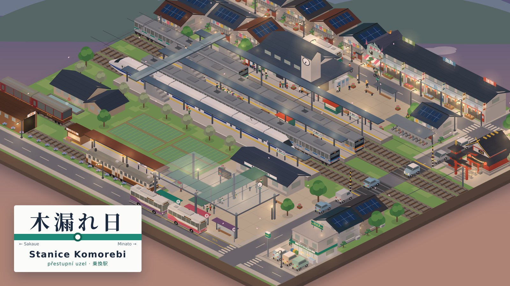

# Stanice Komorebi 木漏れ日駅

Izometrická hra o japonském nádraží v prohlížeči. Začínáš u malé venkovské zastávky v údolí. Vlaky přivážejí a odvážejí cestující, za každou jízdu vyděláváš a peníze investuješ do kolejí, nástupišť a okolí stanice. Víc vlaků přiveze víc lidí a z Komorebi postupně vyroste rušná stanice a přestupní uzel celého údolí.

Hra běží v jediném souboru `index.html`. Nepotřebuje server ani instalaci a ukládá se sama do prohlížeče (localStorage).

## Jak hrát

- **Stanice vydělává sama.** Ty jen v panelu *Investice* vybíráš, co postavíš dál. Nikam se nespěchá.
- **Koleje** zvětšují kapacitu: delší soupravy, hustší jízdní řád, nové koleje a elektrifikace. **Stanice** a **Okolí** přivádějí víc lidí a zvyšují jejich útratu.
- **Uzel** se odemkne, až z Komorebi vyroste rušné město. Pak přibude jižní východ, autobusové nádraží, místní dráha Yamabiko, soukromá dráha Komichi a konbini. Vylepšení zvyšují plynulost přestupů.
- **Kočka štěstí** se občas schová na stanici. Klepni na ni pro bonus. Vzácné vlaky a auta přinášejí víc.
- **Cíl:** postavit rychlík do Tokia a dovést Komorebi až na hlavní stanici údolí. Na konci čeká slavnostní ohňostroj.
- **Ovládání:** tažením posuneš pohled, kolečkem nebo dvěma prsty přiblížíš.

## Spuštění

Stačí otevřít `index.html` v prohlížeči.

### GitHub Pages

1. Nahraj obsah této složky do repozitáře.
2. V repozitáři otevři **Settings → Pages**, zvol **Deploy from a branch**, větev `main` a složku `/ (root)`.
3. Hra poběží na adrese `https://<uživatel>.github.io/<repozitář>/`.

## Poznámky

- Rozehraná hra se ukládá do prohlížeče na dané adrese. Nová verze na stejné adrese načte uloženou hru z předchozí verze.
- Písma se načítají z Google Fonts. Bez internetu hra použije systémová písma.
- Všechny vlaky, autobusy, značky a obchody ve hře jsou vymyšlené a nekopírují žádného skutečného dopravce ani značku.
